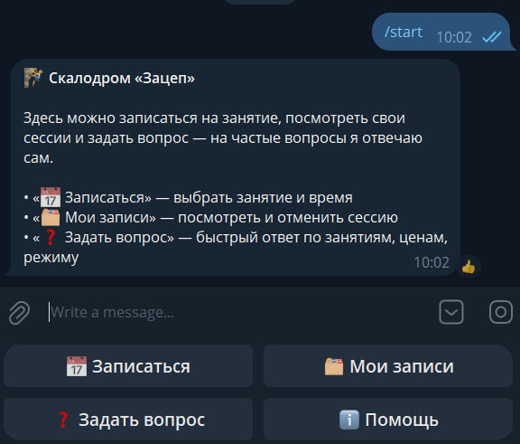
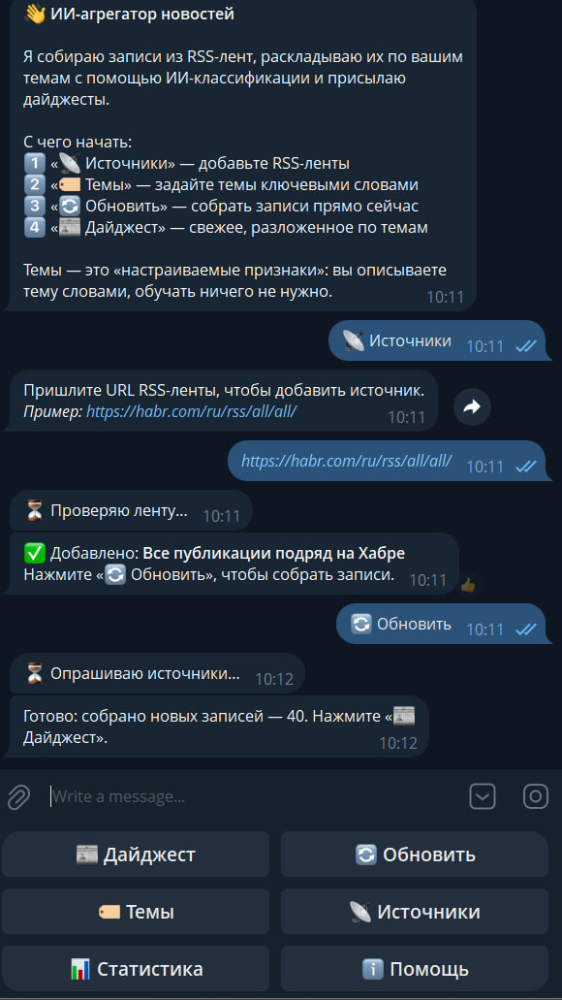
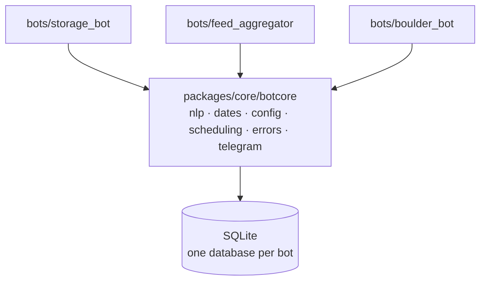

# telegram-bots-platform

[](https://github.com/Kirill-Mik/telegram-bots-platform/actions/workflows/ci.yml)

Three Telegram bots built on one shared package, `botcore`. The package holds
everything the bots have in common: text classification, date parsing,
scheduling, config loading, error handling and the Telegram connection.
Each bot only contains its own handlers and storage layer. The bot interfaces
are in Russian.

Stack: Python 3.11, aiogram 3, SQLite, scikit-learn (TF-IDF), APScheduler,
pytest, ruff, GitHub Actions.

## Bots

| Bot | What it does |
|-----|--------------|
| [storage_bot](bots/storage_bot/) | Personal file storage: folder tree, upload, download, folder export as ZIP |
| [feed_aggregator](bots/feed_aggregator/) | RSS/Atom reader that sorts entries into user-defined topics and sends digests on a schedule |
| [boulder_bot](bots/boulder_bot/) | Booking bot for a climbing gym: time slots, race-free booking, reminders, FAQ search, admin panel |

| boulder_bot | feed_aggregator |
|---|---|
|  |  |

## Architecture



`botcore` modules:

- `nlp` — stemmed TF-IDF with cosine similarity: topic classification for the
  feed reader and question matching for the FAQ;
- `dates` — parses "tomorrow 18:00" or "in 2 hours", stores time in UTC;
- `scheduling` — wrapper around APScheduler that guarantees the first run
  (a job created with `next_run_time=None` is silently paused forever);
- `config` — `.env` loading, `ADMIN_IDS` parsing;
- `errors` — one error handler for all bots: the exception is logged and the
  user gets a message instead of silence;
- `telegram` — bot construction with optional proxy support.

## Design decisions

- **No neural networks or paid APIs.** The bots target a small VPS with
  1–4 GB of RAM. Stemmed TF-IDF gives stable quality on short texts, starts
  instantly and needs no API keys.
- **Race-free booking.** A slot is taken with
  `UPDATE slots SET booked = 1 WHERE id = ? AND booked = 0` and a rowcount
  check, so two users booking the same slot cannot both succeed.
- **Reminders are marked as sent only after delivery succeeds.**
- **Feeds are fetched with httpx** (15 s timeout, ETag / If-Modified-Since),
  the TF-IDF topic model is fitted once per polling cycle, not per entry.
- **Only numeric ids in callback_data** — Telegram limits it to 64 bytes.

## Running a bot

```bash
python -m venv venv
source venv/bin/activate          # Windows: venv\Scripts\activate
pip install -e .

cp bots/storage_bot/.env.example bots/storage_bot/.env   # set BOT_TOKEN
python -m bots.storage_bot
```

Every bot has its own token, so its `.env` lives in the bot's folder.
Values from `bots/<bot>/.env` override a shared `.env` in the repository root,
which lets all three bots run at the same time.

The other bots start the same way: `python -m bots.feed_aggregator`,
`python -m bots.boulder_bot` (`python -m bots.boulder_bot.seed` loads demo data).

If `api.telegram.org` is only reachable through a proxy, set `BOT_PROXY`
(or `HTTPS_PROXY`). aiohttp, which aiogram uses, does not read system proxy
settings by itself.

## Tests

```bash
pip install -e ".[dev]"
ruff check .
pytest
```

Tests need neither network nor Telegram: databases are created in a temporary
folder, HTTP and message sending are stubbed. CI runs ruff and pytest on
Python 3.11.

## Repository layout

```
packages/core/botcore/   shared package
bots/<bot>/              main.py, handlers/, services/, README.md, .env.example
tests/                   pytest: botcore and the core logic of each bot
docs/                    screenshots
.github/workflows/       CI
```

## License

MIT
